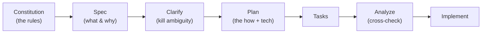
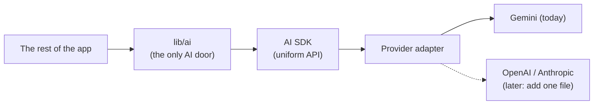
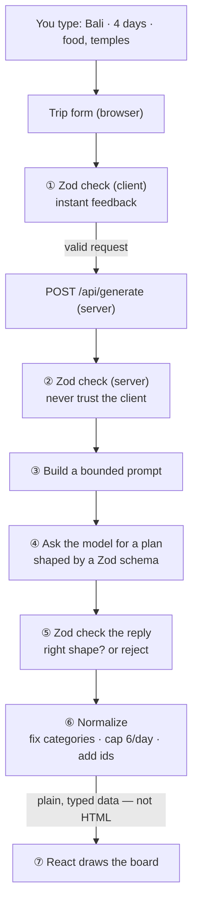
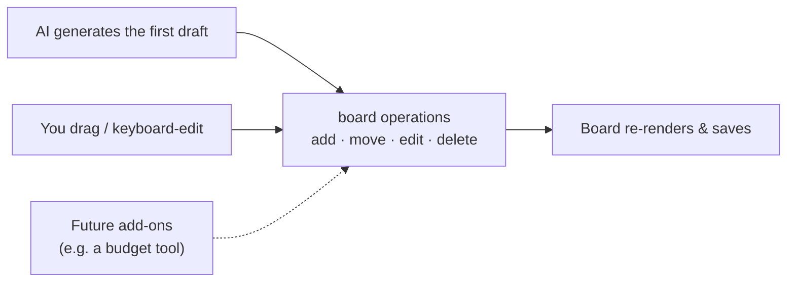

# I built a GenAI travel planner that survives the AI having a bad day

Most AI travel demos look slick until the model returns garbage, times out, or gets quietly retired. Mine keeps working — because the decisions that mattered happened on paper, before I wrote a line of code.

This is the story of how Roam Board turns *"Bali, 4 days, food and temples"* into a day-by-day board you can drag around, and why I treated the AI like a fickle contractor instead of a miracle.

**Live demo:** _(link)_ · **Code:** _(link)_

---

## So what does it actually do?

You type a sentence about a trip. You get a Kanban board back — one column per day, a card for each activity. Then you rearrange it, edit it, build one from scratch, or save and share it.

Simple to use. The fun is underneath, and it rests on two stubborn choices:

- **Plan first, code second.** I used Spec-Driven Development (SDD) to decide the hard things while they were still cheap to change.
- **The AI is a part, not the point.** Every model call goes through one small door with a timeout, a validator, and logging. The app never trusts the model blindly, and it doesn't fall apart when the model does.

Both choices pay off later in this post. One of them turned a feature I hadn't built yet into zero future work. The other turned a dependency getting *deleted* into a one-line shrug.

---

## Why write a spec before writing code?

Here's the uncomfortable truth about most side projects: the first thing you type is usually the thing you regret. A choice you make in the first hour of coding can cost you a weekend to unmake.

So I didn't start in the editor. I started in a document, using **Spec Kit** — a toolkit for SDD. You move through a short pipeline, one artifact at a time, and each step has exactly one job:



The trick is that the stages stay apart on purpose. The spec says *what* with zero technology in it. The plan is the only place tech shows up. Keep those separate and you can swap your whole stack later without rewriting what the app is supposed to be.

Sounds like paperwork. It's actually the cheapest insurance you'll ever buy. Three moments made that obvious.

### A sentence in a doc deleted a whole sprint

One rule in my constitution said: the core data carries fields for features I haven't built yet. So from the first commit, every activity quietly holds empty slots for cost, map coordinates, and accessibility info.

Nothing used them. That's the point.

When I add a budget meter or a map later, they drop straight in. The naive version of that change — bolting new fields onto saved data after the fact — usually means a migration across every trip anyone has ever stored. That's the kind of job that eats a week and occasionally corrupts real users' data. I skipped it entirely, with a sentence.

### The same habit made a vanishing model a non-event

Another rule: all AI access goes through one boundary, and the model name is config, not code. I wrote that down before building anything.

Weeks later it saved me (full story below). My model got retired mid-testing, and the fix was changing one value. No archaeology. The repair was cheap because the decision was early.

### Clarify caught a bad idea before I shipped it

My spec first said "share a trip by exporting a file." During Spec Kit's *clarify* step, one question stopped me cold: is a raw data file actually pleasant for a human to read?

It isn't. I'd quietly mashed two different jobs into one. Backing up a trip wants a file; sending it to a friend wants something readable. I split them on paper, before any code existed. (More on that near the end.)

None of this is ceremony. SDD front-loads the expensive calls to when they cost nothing, and it leaves a paper trail — a constitution, specs, decision records — that explains *why* the app looks the way it does. For anyone reviewing the work, that trail is worth as much as the code.

---

## How do you build on something this unreliable?

Let's be honest about what an LLM is as a dependency:

- Ask it twice, get two different answers.
- Every call costs money.
- It can be slow, flaky, or confidently wrong.
- And the models themselves vanish — the one you shipped on can be gone next month.

So the real question was never "how do I call an AI?" It was "how do I make something *feel* solid on top of something that isn't?"

Two ideas did the heavy lifting.

---

## One door for every AI call

Nothing in the app talks to the model directly. Every call goes through a single module, `lib/ai`. One controlled doorway, not a dozen side entrances.



The piece worth staring at is the **provider adapter**. Most of `lib/ai` is written against a generic idea of "a model" — it has no clue who makes it. Only one tiny file actually names a vendor:

```ts
// lib/ai/providers/google.ts — the ONLY place a vendor is named
import { createGoogleGenerativeAI } from "@ai-sdk/google";

export function getGoogleModel(apiKey: string, modelId: string) {
  // Hands back a provider-agnostic "model" the rest of the app can use.
  return createGoogleGenerativeAI({ apiKey })(modelId);
}
```

```ts
// lib/ai/index.ts — doesn't know or care which vendor this is
const model = getGoogleModel(apiKey, modelId);
const result = await generateText({ model, /* ...schema, prompt... */ });
```

Why bother? Three payoffs, and I'd only defend this pattern because of the third.

Switching providers becomes *additive*. Want OpenAI? Write `providers/openai.ts` that returns the same shape of "model," flip a config value, done. The route, the UI, the domain logic — none of them move. No vendor name leaks past that one file.

It's also the single place to enforce the rules. Timeout, output-checking, cost logging, and later rate-limiting — they all live at this one door instead of scattered across the app.

And it makes testing trivial. Mock one function and the whole AI path is deterministic. That's exactly how the test suite checks timeouts, bad keys, and junk output without ever hitting a real model.

A thin wrapper that only forwards calls would be a waste. This one earns its keep because it's also where every safety rule lives.

---

## Ask the model for data, not a web page

This is the idea I'd tattoo on the project if I could: **I never ask the model for a user interface. I ask it for data, check that data hard, then draw the screen myself.**

Plenty of "AI builds your UI" demos ask for HTML and render whatever lands. That's how you get mangled layouts and security holes. Instead, your words take a round trip through a series of checkpoints, and a library called **Zod** stands guard at each one.



Zod, in one line: you describe the exact shape data must have, and it both checks real values at runtime *and* generates the matching TypeScript type. Write it once, use it four ways.

```ts
// ONE definition...
const Activity = z.object({
  name: z.string().min(1).max(120),
  description: z.string().max(600),
  category: z.enum(["food","sightseeing","outdoors","culture",
                    "nightlife","shopping","transit","accommodation","other"]),
  dayPart: z.enum(["morning","afternoon","evening"]),
});

// ...and the type comes free from that same source of truth:
type Activity = z.infer<typeof Activity>;
```

Now walk the seven steps, and notice where that one schema keeps showing up:

1. **Client check.** As you fill the form, Zod validates the request. Ask for 0 or 9 days and you get an instant, friendly error — no wasted network call.
2. **Server re-check.** The browser is untrusted, so the server runs the *same* schema again. Size caps live here too, so a tampered client can't send a 10,000-word prompt and run up your bill.
3. **Build a bounded prompt.** The validated request becomes a tight instruction — "4-day Bali plan, 6 activities max per day, categories from this list." Your free text is length-capped before it reaches the model.
4. **Ask for structured data.** The key move: I hand the AI SDK a Zod schema and say "return data in *this* shape," not "write me some text." The model is steered toward clean JSON, not prose or HTML.
5. **Check the reply.** The model's answer gets treated like a message from a stranger — parsed against the schema. Missing field? Wrong type? Rejected. You see "couldn't make a valid plan, try again," never a half-broken board.
6. **Normalize.** Even a valid-shaped reply gets tidied to match the rules: trim to the right number of days, cap the activities, map a surprise category like "beach" to `other`, attach stable ids. The app owns the final structure, not the model.
7. **Draw the board.** Only now, holding plain typed data, does React render. The drawing step is boring and safe. Exactly what you want.

One schema validates your input, constrains the model, checks its output, and types everything in between. That's what "the app stays in charge" looks like in practice.

---

## Bring your own key — and survive without it

The app uses BYOK: you paste your own (free) Google Gemini key, and it lives on your device, never on a server. For a portfolio app that strangers might poke at, that means I'm not paying for — or policing — everyone's usage.

The flip side is a rule I stole from good offline-first apps. The AI is a bonus, not a crutch. No key, a failed request, a timeout — you can still build a trip by hand, edit it, and save it. The screen never dies just because the model is unavailable.

---

## The week my model vanished three times

This is where those day-0 rules cashed out. I shipped on a reasonable Gemini model. Then, across a few days of testing, the same dependency broke on me three different ways:

It got slow — doing a hidden "thinking" step I didn't need for a travel list, adding tens of seconds and triggering timeouts. My fix for that got rejected as an invalid setting. And the model I switched to next had been retired outright, the API answering with a flat "this model is no longer available."

In most codebases that's a tense week of find-and-replace and guesswork.

Here, each fix was one line. Two reasons, both decided before any of it happened:

- The model name is config, not code — so switching is editing a value, not hunting through files.
- The one door logs the real error — the server printed exactly what the provider said, including which model to use instead. I wasn't debugging blind. I was following instructions.

The takeaway I'd put on a slide: treat an AI model like a third-party service that will change without warning. Because it will. Build the seams up front and the churn turns boring.

---

## Can you use the board without a mouse? *(short add-on)*

Generating a draft is half the job — you'll always want to tweak it. So the board is fully editable: add, edit, delete, reorder within a day, move across days, add or drop whole days.

The part I'm proud of: it all works without a mouse. Kanban boards are the classic drag-only interface that shuts out keyboard and screen-reader users. This one doesn't — drag with a mouse, *or* move a card with plain buttons and your keyboard, and a screen reader calls out each move. And it's measured, not claimed: an automated accessibility audit scores it 100/100, and that check runs on every change.

---

## Backup vs. the thing you actually send a friend *(short add-on)*

Your trip saves on your device automatically. Reload and it's still there, no account needed. Keep several, open any of them.

Remember that clarify question — is a data file nice to *read*? The answer became two honest buttons instead of one confused one:

- **Back up / transfer** → a file you can re-open later or on another device, exactly as it was.
- **Copy as text** → a clean, readable itinerary you paste straight into a message. That's the one you share.

Two jobs, two buttons. No file pretending to do both.

---

## One set of moves, many ways to trigger them

Step back and there's a quiet choice under everything: every change to the board — from the AI, your mouse, or your keyboard — runs through the same small set of operations.



Generation seeds the board. Editing changes it. Both call the same tested, pure functions. That's why the app feels coherent instead of bolted together — and it's why a new way to drive the board would be an addition, not a rewrite. I built it to grow sideways.

---

## What all this actually bought me

An app where the AI is contained, checked, and replaceable — proven the week a model broke three times and each fix was one line. A pipeline where a single Zod schema validates your input, constrains the model, checks its output, and types the lot, so a non-deterministic model still produces reliable screens. A codebase that's typed, tested (36 unit, integration, and accessibility tests plus 5 end-to-end), audited 100/100 for accessibility, and backed by a commit history that reads like a logbook of decisions.

Here's the question I keep coming back to, and I'll hand it to you: the next time you reach for an AI API, are you building it into your app, or building a door it has to knock on? One of those is a lot easier to live with when the model has a bad day.

*Code · live demo · and the full constitution, specs, and decision records are in the repo.*
